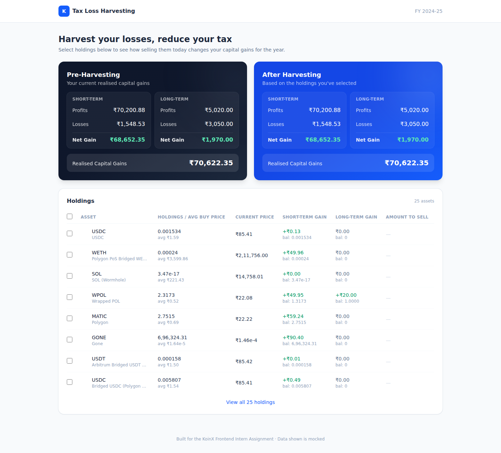
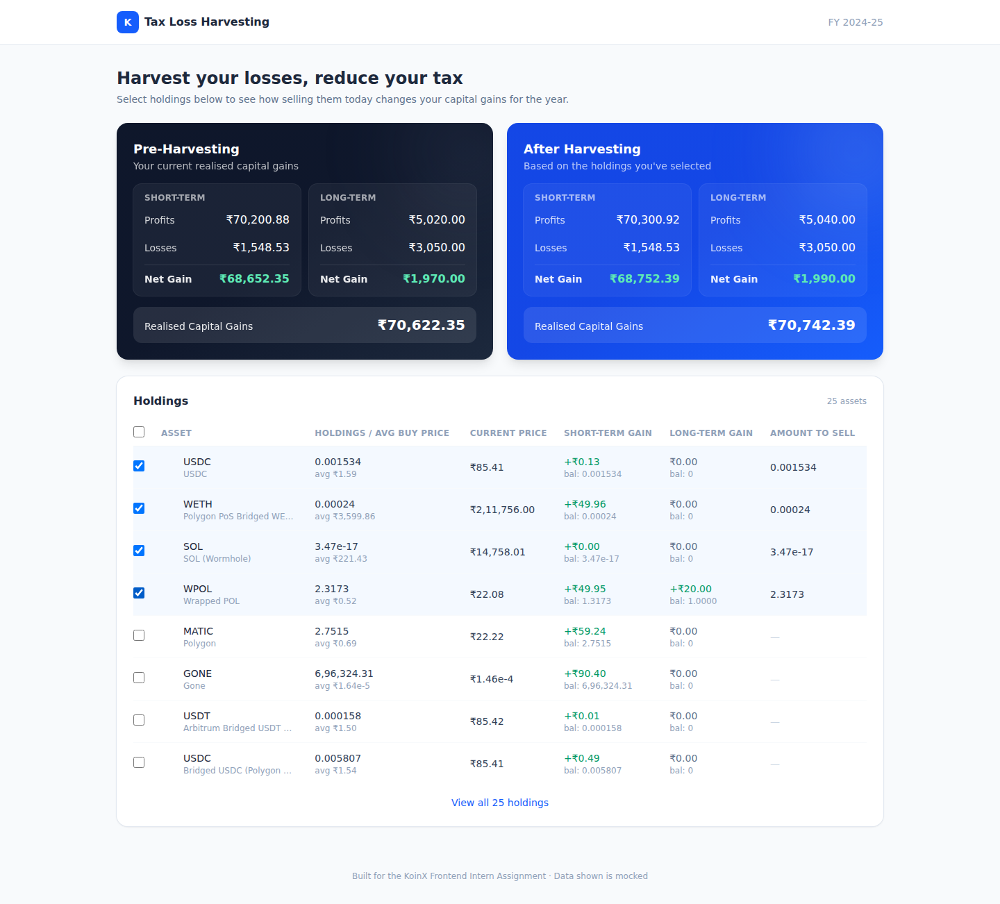
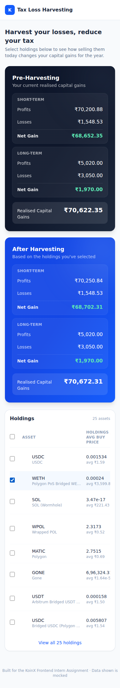

# Tax Loss Harvesting — KoinX Frontend Intern Assignment

A responsive React + TypeScript tool that shows a user's realised capital gains before and
after "harvesting" (selectively selling) crypto holdings, to help minimise tax liability.

## Live demo

> Deployed link: _add your Vercel/Netlify URL here after deploying_

## Screenshots

**Desktop — initial state (nothing selected)**



**Desktop — after selecting a few holdings** (net gains drop, savings banner appears)



**Mobile view**



## Tech stack

- **React 19 + TypeScript**, bootstrapped with **Vite**
- **Tailwind CSS v4** for styling
- Mock APIs implemented as promise-based functions with simulated network
  latency (see [`src/api/mockApi.ts`](./src/api/mockApi.ts)) — no real backend/server needed
- No external state management library — the app is small enough that a single
  custom hook (`useTaxHarvesting`) plus `useState`/`useMemo` is sufficient and keeps the
  data flow easy to follow

## Getting started

```bash
# 1. Install dependencies
npm install

# 2. Run the dev server
npm run dev
# App runs at http://localhost:5173

# 3. Build for production
npm run build

# 4. Preview the production build locally
npm run preview
```

## Project structure

```
src/
├── api/
│   ├── mockApi.ts          # fetchHoldings() / fetchCapitalGains() — simulated network calls
│   └── mockData/
│       ├── holdings.json        # Holdings API dummy response
│       └── capitalGains.json    # Capital Gains API dummy response
├── components/
│   ├── CapitalGainsCard.tsx     # Pre/After-harvesting card (dark & blue variants)
│   ├── HoldingsTable.tsx        # Selectable holdings table with "view all"
│   ├── LoadingState.tsx         # Skeleton loader
│   └── ErrorState.tsx           # Error + retry UI
├── hooks/
│   └── useTaxHarvesting.ts      # Fetches data, owns selection state, derives all gain figures
├── types/
│   └── index.ts                 # Shared TypeScript types
├── utils/
│   ├── format.ts                # Currency / quantity formatting helpers
│   └── gains.ts                  # Pure functions for the tax-harvesting math
├── App.tsx
└── main.tsx
```

## How the numbers are calculated

For any profit/loss breakdown:

```
Net Short Term Gain   = stcg.profits - stcg.losses
Net Long Term Gain    = ltcg.profits - ltcg.losses
Realised Capital Gain = Net Short Term Gain + Net Long Term Gain
```

- The **Pre-Harvesting** card always reflects the raw Capital Gains API response.
- The **After Harvesting** card starts as a mirror of Pre-Harvesting. As holdings are
  checked/unchecked in the table, each selected holding's `stcg.gain` and `ltcg.gain` are
  folded into the base profits/losses (positive gain → added to profits, negative gain →
  its magnitude added to losses), and the net/realised figures are recomputed —
  all client-side, in real time (`applySelections` / `deriveGains` in `utils/gains.ts`).
- The **"You're going to save ₹X"** banner is shown only when
  `preHarvesting.realised > postHarvesting.realised`, and `X` is that difference.

This logic is unit-testable in isolation since it's implemented as pure functions
decoupled from React (see `utils/gains.ts`).

## Assumptions

- The two JSON payloads shared in the assignment are used verbatim as the mock API
  responses, served through `Promise`-returning functions with an artificial ~700ms
  delay (`src/api/mockApi.ts`) to simulate real network calls and exercise the
  loading state. There's a `SIMULATE_ERROR` flag in that file to preview the error state.
- The **Holdings API** contains two separate `USDC` rows (different bridged variants
  with identical `coin` symbols). Since `coin` alone isn't a unique key, table rows are
  keyed by `coin + coinName` instead, so both render and behave as independent,
  selectable rows.
- **"Amount to Sell"** is populated with the holding's `totalHolding` the moment it's
  selected (per the spec) — this is a read-only preview of what selling the full position
  would sell, not an editable/partial-sell input, since the assignment doesn't call for
  partial selling.
- Selecting a holding always applies **both** its `stcg.gain` and `ltcg.gain` to the
  respective buckets (per the worked example in the brief), even when one bucket's
  `balance` is `0` — a `0`/`0` bucket simply contributes `0` and has no visible effect.
- Extremely small "dust" balances (e.g. `1e-14`) in the sample data are formatted with
  scientific notation rather than rounded to `0`, so every row stays meaningfully
  distinguishable.
- Rows are sorted by the order returned from the Holdings API (i.e. left as-is), since the
  brief only asks for "any logical order" and doesn't specify a sort key.
- Currency is formatted in INR (₹) using Indian digit grouping, matching the
  Rupee figures in the sample API responses.

## Bonus features implemented

- ✅ Mobile responsive (cards stack, table scrolls horizontally on small screens)
- ✅ Reusable, composable components (`CapitalGainsCard`, `HoldingsTable`, etc.)
- ✅ State managed via a single custom hook (`useTaxHarvesting`) — no prop drilling
- ✅ Visual feedback on selection (row highlight, live-updating card, savings banner)
- ✅ Loading skeleton and error state (with retry) for the mock API calls
- ✅ "View all" / "Show less" toggle in the holdings table (collapsed to 8 rows by default)
